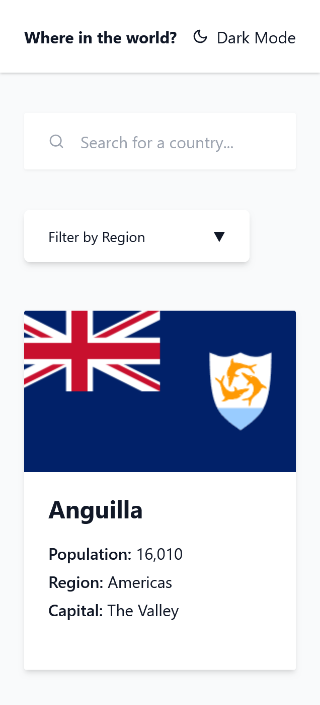
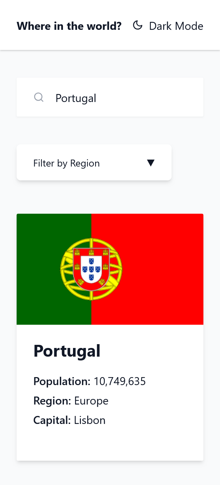
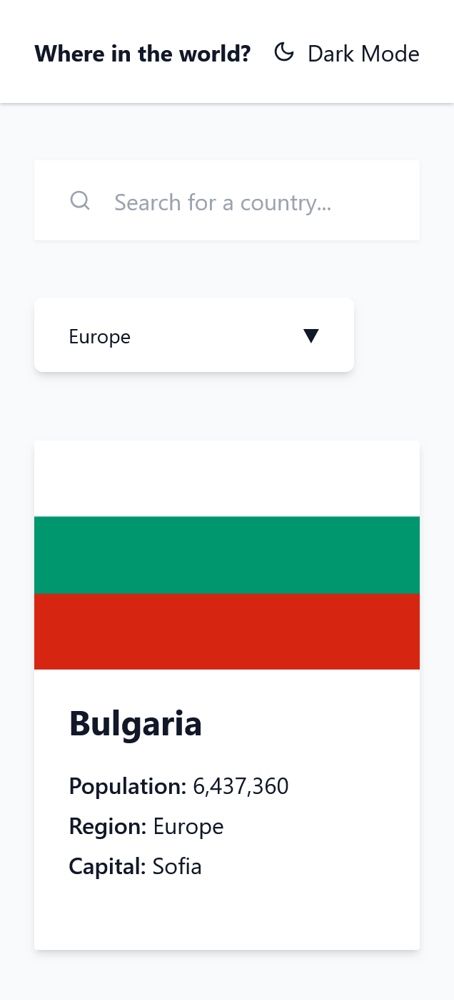
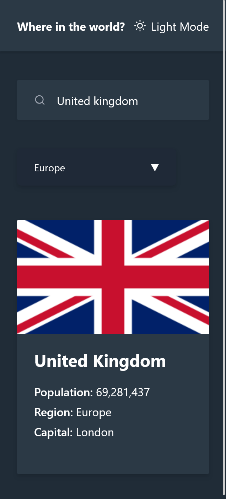
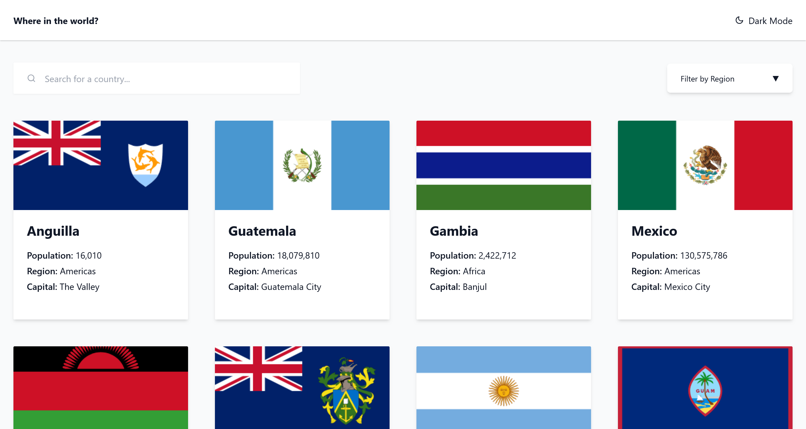
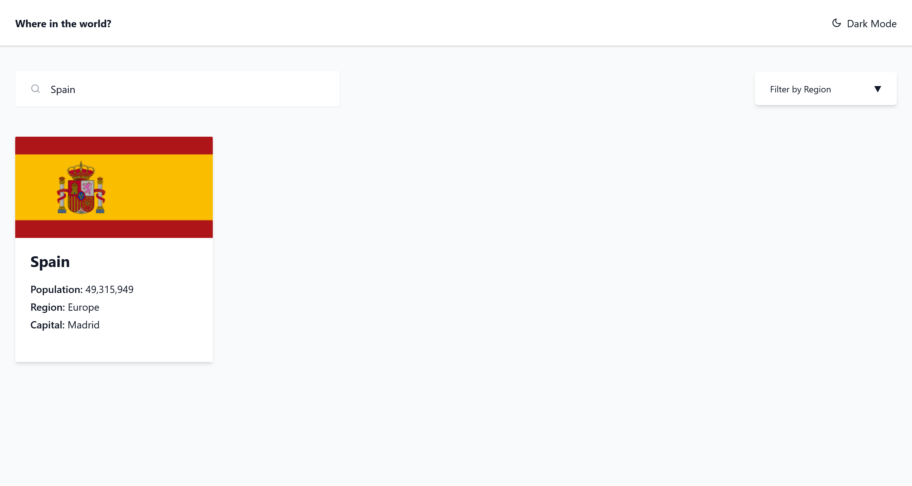
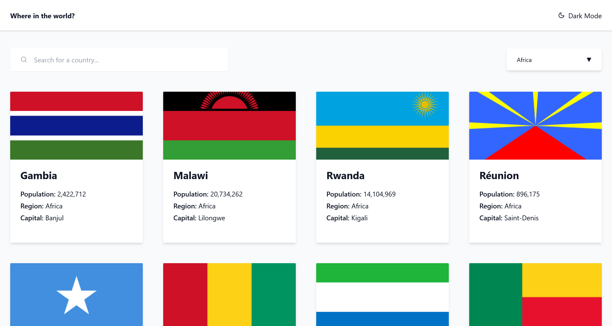
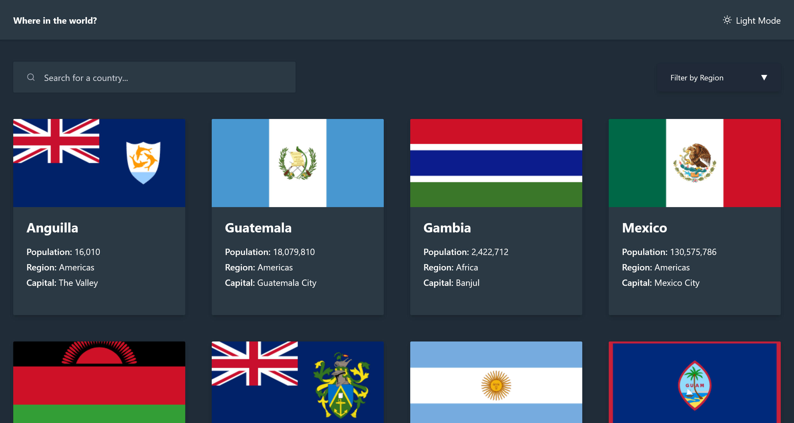

# REST Countries API with Color Theme Switcher

A responsive country information application built with **React, Redux Toolkit, React Router and Tailwind CSS**, using the REST Countries API to retrieve and display country information.

This project is a solution to the [REST Countries API with Color Theme Switcher challenge on Frontend Mentor](https://www.frontendmentor.io/challenges/rest-countries-api-with-color-theme-switcher-5cacc469fec04111f7b848ca).

The application allows users to explore countries, search by name, filter by geographical region, view detailed country information and navigate between neighbouring countries.

It also implements **build-time pre-rendering and React hydration** to ensure country cards are included in the initial HTML rather than waiting for client-side data fetching.

---

## Live Demo

**Live Site:** https://rest-countries-api-psi-five.vercel.app/

**GitHub Repository:** https://github.com/Mario-Balde/Rest-Countries-API

---

## Features

### Country Exploration

- Display countries retrieved from the REST Countries API.
- Search for countries by name.
- Filter countries by geographical region.
- View detailed information about individual countries.
- Navigate between neighbouring countries using their alpha-3 country codes.

### Theme Management

- Toggle between light and dark themes.
- Persist the selected theme using localStorage.
- Restore the previously selected theme when returning to the application.

### State Management and Navigation

- Manage global search and region filter state using Redux Toolkit.
- Navigate between pages using React Router.
- Reuse components to maintain a consistent application structure.

### Performance and Rendering

- Pre-render the React application at build time.
- Generate initial HTML using React's `renderToString()`.
- Hydrate the pre-rendered HTML in the browser using `hydrateRoot()`.
- Embed the initial country dataset into the generated HTML.
- Resolve neighbouring countries locally using the shared country dataset, avoiding individual external API requests for each border country.

### Responsive Design

- Mobile-first responsive layout.
- Optimised presentation for mobile, tablet and desktop screens.

---

## Built With

| Technology         | Purpose                              |
| ------------------ | ------------------------------------ |
| React 19           | Component-based user interface       |
| JavaScript (ES6+)  | Application logic                    |
| Redux Toolkit      | Global state management              |
| React Redux        | Connecting React components to Redux |
| React Router DOM   | Client-side routing                  |
| Tailwind CSS       | Responsive styling                   |
| React Icons        | Interface icons                      |
| Vite               | Development server and build tooling |
| Vercel             | Hosting and serverless API functions |
| REST Countries API | Country information and data         |

---

## Application Architecture

The application uses a build-time pre-rendering approach followed by client-side hydration.

### 1. Build-Time Pre-rendering

Before deployment, the pre-rendering script:

1. Fetches the country dataset from the deployed API endpoint.
2. Loads the server-rendering entry point using Vite.
3. Creates the initial React HTML using `renderToString()`.
4. Inserts the rendered HTML into `dist/index.html`.
5. Embeds the initial country dataset into the generated HTML.

This allows the browser to receive HTML containing the country cards immediately.

### 2. Client-Side Hydration

When the browser loads the application:

1. `main.jsx` reads the embedded country dataset from `window.__INITIAL_COUNTRIES__`.
2. `hydrateRoot()` attaches React to the pre-rendered HTML.
3. Redux Provider makes the global store available to components.
4. BrowserRouter enables client-side navigation.
5. The application becomes fully interactive.

### 3. Country Data and Border Navigation

The shared country dataset contains the information required by both the home page and country details page.

Each country includes its alpha-3 code (`cca3`) and an array of neighbouring country codes (`borders`).

When a user selects a border country, the application matches the border code against the `cca3` property in the shared dataset.

This avoids making separate API requests for neighbouring countries and helps reduce unnecessary external API traffic.

---

## Project Structure

```text
04_rest-countries/
│
├── api/
│   ├── countries.js
│   ├── country.js
│   └── hello.js
│
├── public/
│
├── scripts/
│   └── prerender.js
│
├── screenshots/
│
├── src/
│   ├── components/
│   │   ├── CountryCard.jsx
│   │   ├── Filter.jsx
│   │   ├── Header.jsx
│   │   └── Search.jsx
│   │
│   ├── data/
│   │   └── countries.json
│   │
│   ├── pages/
│   │   ├── CountryDetails.jsx
│   │   └── Home.jsx
│   │
│   ├── redux/
│   │   ├── regionSlice.js
│   │   ├── searchSlice.js
│   │   └── store.js
│   │
│   ├── utils/
│   │   └── normaliseCountry.js
│   │
│   ├── App.jsx
│   ├── entry-server.jsx
│   ├── index.css
│   └── main.jsx
│
├── eslint.config.js
├── index.html
├── package.json
├── postcss.config.js
├── tailwind.config.js
├── vercel.json
└── vite.config.js
```

### Key Files and Responsibilities

| File                 | Responsibility                                                |
| -------------------- | ------------------------------------------------------------- |
| `main.jsx`           | Client entry point, React hydration and application providers |
| `App.jsx`            | Application layout, routing and theme management              |
| `entry-server.jsx`   | Server-side rendering entry point                             |
| `Home.jsx`           | Country listing, search and regional filtering                |
| `CountryDetails.jsx` | Displays country information and handles border navigation    |
| `CountryCard.jsx`    | Reusable country card component                               |
| `store.js`           | Configures the global Redux store                             |
| `regionSlice.js`     | Manages the selected geographical region                      |
| `searchSlice.js`     | Manages the country search query                              |
| `countries.js`       | Retrieves, paginates and transforms country data              |
| `prerender.js`       | Fetches data and generates the pre-rendered HTML              |

---

## API Integration

The application uses the REST Countries API to retrieve country information.

The Vercel serverless API endpoint `/api/countries`:

- Authenticates using an API key stored in an environment variable.
- Retrieves country data in paginated batches of 100.
- Continues fetching until all available countries have been retrieved.
- Transforms the API response into a consistent structure for the frontend.
- Returns country information, including flags, population, region, capital, native names, currencies, languages and neighbouring country codes.
- Uses HTTP cache headers to reduce repeated external API requests.

The API key is stored securely in Vercel environment variables and is not exposed in the frontend.

**Note:** `api/country.js` is retained as an individual-country endpoint, although the current country details page uses the shared dataset for local country lookups.

---

## Screenshots

### Mobile Preview

**Landing Page**



**Search Mode**



**Filter Mode**



**Dark Mode**



### Desktop Preview

**Landing Page**



**Search Mode**



**Filter Mode**



**Dark Mode**



---

## Getting Started

### Prerequisites

- Node.js
- npm
- A REST Countries API key configured in the Vercel environment for the deployed API.

### Installation

Clone the repository:

```bash
git clone https://github.com/Mario-Balde/Rest-Countries-API.git
```

Navigate into the project directory:

```bash
cd Rest-Countries-API
```

Install dependencies:

```bash
npm install
```

### Run the Development Server

```bash
npm run dev
```

The application will be available at the local development URL displayed by Vite.

### Run ESLint

```bash
npm run lint
```

### Create a Production Build

```bash
npm run build
```

The build command performs two operations:

1. Runs `vite build` to compile the frontend assets.
2. Runs `scripts/prerender.js` to fetch country data and generate the pre-rendered HTML.

**Note:** The pre-rendering script retrieves country data from the deployed Vercel API endpoint.

### Preview the Production Build

```bash
npm run preview
```

This serves the generated production files locally.

---

## What I Learned

Through this project, I developed my understanding of:

- Building reusable and maintainable React components.
- Managing global application state with Redux Toolkit.
- Implementing client-side routing with React Router.
- Fetching, handling and transforming external API data.
- Working with paginated API responses.
- Implementing serverless API functions with Vercel.
- Understanding server-side rendering and build-time pre-rendering.
- Hydrating server-rendered HTML using React.
- Sharing initial data between the rendering process and the browser.
- Improving API efficiency by resolving related data locally.
- Managing application preferences using localStorage.
- Implementing responsive layouts and theme switching with Tailwind CSS.
- Deploying and maintaining a React application using GitHub and Vercel.

---

## Author

**Mario Balde**

- GitHub: [@Mario-Balde](https://github.com/Mario-Balde)
- Frontend Mentor: [@Mario-Balde](https://www.frontendmentor.io/profile/Mario-Balde)
- LinkedIn: [mario-balde](https://www.linkedin.com/in/mario-balde-44b994b5/)

---

_This project was developed as part of my frontend development portfolio and as an opportunity to strengthen my practical knowledge of React, JavaScript, state management, API integration and modern frontend architecture._
